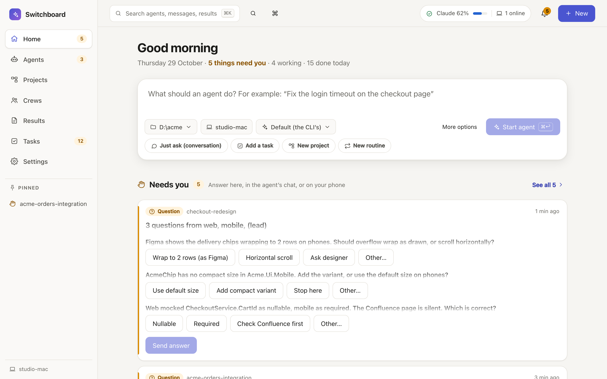

# Switchboard

[](https://m8ven.ai/mcp/marcingadomski94/switchboard?s=readme)

<a href="https://www.paypal.com/donate/?hosted_button_id=S9P6C8KLXWRZN" target="_blank" rel="noopener noreferrer"></a>

Switchboard is a local web app for running many **Claude Code**, **Codex CLI** and **OpenCode** agents at once. Watch every agent work live, answer all their questions from one place, and let Switchboard handle the repetitive parts: tasks, projects, routines, test fixes and account switching. It runs on `127.0.0.1` only, drives the unmodified CLIs with your own logins, sends no telemetry, and updates itself from GitHub releases.



## Switchboard 2

Switchboard 2 opens in a new look, the **v2 theme**, with plain words instead of jargon (agents, tasks, projects, results; [the glossary](docs/v2.md#glossary-the-new-names)), in light or dark, on desktop, tablet and phone:

- **Home:** what needs you, what is working now and what got done today, with a box to start an agent ([the whole page](docs/screenshots/home-full.png)).
- **Needs you:** one queue for every question, approval and alert, from every agent, project step, teammate and computer; the same cards sit in each agent's chat.
- **Agents:** List, Chats or Board, sorted into folders you drag agents into.
- **The agent view:** the chat with its answer cards, and a side panel (⌘.) with the agent's project, notes, working memory, helpers and settings.
- **Projects:** multi-step work whose steps start on their own when the steps before them are done (Steps, Board, Graph, Timeline).
- **Crews:** long-lived teammates with a job description, grouped into crews, handing work to each other.
- **Results:** everything agents saved on purpose, with versions.
- ⌘K for everything; a short tour, "Welcome to Switchboard 2", shows the new places once.


| Agents · Board | Agents · List and folders |
|---|---|
|  |  |
| **A project (Graph)** | **A crew** |
|  |  |
| **Needs you** | **Dark** |
|  |  |

<p> </p>

**Prefer the 1.x look?** It stays as the **Classic theme**, with the same agents, data and settings. Switch in Settings → Appearance → Theme, or press ⌘K and type "classic"; Classic switches back in its Settings → Appearance. Each browser and phone keeps its own choice. [More on the themes](docs/v2.md#switching-themes-for-users)

## Features

- **Agents** on three AI engines in any folder or separate copy (git worktree), with helper chats, undo per turn and engine switching mid-way. [new agent](docs/new-session.md) · [chat](docs/chat.md) · [undo](docs/undo.md)
- **Conversations** to plan with a read-only agent, then continue as an agent to code. [conversations](docs/chats.md)
- **Needs you:** every question and permission request in one place; agents report with `turn_status`, so an agent waiting on you says so. [needs you](docs/inbox.md)
- **Tasks** kept by the agent, with estimates, a board, issue import and runs in their own copy. [tasks](docs/todos.md)
- **Results** saved on purpose (Markdown, HTML, Mermaid, images, CSV, PDF), with versions and deletion. [results](docs/artifacts.md)
- **Search** across every message, result and task on every computer. [search](docs/search.md)
- **Routines** that Switchboard fires on a schedule or in a loop, kept across restarts. [loops](docs/loops.md) · [schedules](docs/schedules.md)
- **Automatic tests:** failing checks on a change request go back to the agent; green ones offer Combine. [ci](docs/ci.md)
- **Accounts and credits:** several logins per AI engine, switched on usage limits, allowance before paid credits. [accounts](docs/accounts.md) · [usage](docs/usage.md)
- **Insights** into time, tokens, estimate accuracy, rework, cost and limit forecasts. [insights](docs/insights.md)
- **Computers** paired over Tailscale, with shared accounts, folders and power stats, and agent take-over. [computers](docs/peers.md) · [power](docs/power.md)
- **Phones and tablets:** pair with a QR code, get push notifications, install as an app. [phones](docs/devices.md) · [app](docs/install-app.md)
- **Projects** run tasks as steps of a dependency graph, with Jira import, approval modes and Done on combine. [projects](docs/plans.md)
- **Crews** of teammates with job descriptions, budgets and access. [crews](docs/team.md)
- **Notes** ("What agents know") that you approve before any agent gets them. [notes](docs/memory.md)
- **Built-in `switchboard` MCP tools** (connections) for tasks, results, routines and `turn_status` in every agent. [mcp](docs/mcp.md)

## Requirements

- Node.js 24 or newer, and git
- Claude Code (`claude`), signed in with a claude.ai subscription
- Optional: Codex CLI, OpenCode, the GitHub CLI (`gh`), Tailscale, a Jira Cloud token

How to install them per OS: [docs/setup.md](docs/setup.md#requirements).

## Install

Each block downloads a release, extracts it only when its checksum matches, installs it, and starts Switchboard now and at every sign-in. Paste a block as a whole. Replace `2.0.1` with the [latest release](https://github.com/MarcinGadomski94/switchboard/releases/latest) if a newer one exists. Other ways to run it (without the service, from source): [docs/setup.md](docs/setup.md).

**macOS:**

```sh
V=2.0.1
DIR=~/Applications/Switchboard
mkdir -p "$DIR"
cd "$DIR"
curl -LO https://github.com/MarcinGadomski94/switchboard/releases/download/v$V/switchboard-$V.tar.gz
curl -LO https://github.com/MarcinGadomski94/switchboard/releases/download/v$V/switchboard-$V.tar.gz.sha256
shasum -a 256 -c switchboard-$V.tar.gz.sha256 && tar -xzf switchboard-$V.tar.gz
cd switchboard-$V
npm ci --omit=dev
npm run service:install -- --start
```

**Linux:**

```bash
V=2.0.1
DIR=~/.local/opt/switchboard
mkdir -p "$DIR"
cd "$DIR"
curl -LO https://github.com/MarcinGadomski94/switchboard/releases/download/v$V/switchboard-$V.tar.gz
curl -LO https://github.com/MarcinGadomski94/switchboard/releases/download/v$V/switchboard-$V.tar.gz.sha256
sha256sum -c switchboard-$V.tar.gz.sha256 && tar -xzf switchboard-$V.tar.gz
cd switchboard-$V
npm ci --omit=dev
npm run service:install -- --start
```

**Windows** (PowerShell; closing the console window the task opens stops Switchboard, so minimise it):

```powershell
$V = "2.0.1"
$Dir = "$env:LOCALAPPDATA\Programs\Switchboard"
New-Item -ItemType Directory -Force $Dir | Out-Null
Set-Location $Dir
curl.exe -LO "https://github.com/MarcinGadomski94/switchboard/releases/download/v$V/switchboard-$V.tar.gz"
curl.exe -LO "https://github.com/MarcinGadomski94/switchboard/releases/download/v$V/switchboard-$V.tar.gz.sha256"
$Expected = (Get-Content "switchboard-$V.tar.gz.sha256").Split(" ")[0]
$Actual = (Get-FileHash "switchboard-$V.tar.gz" -Algorithm SHA256).Hash.ToLower()
if ($Actual -eq $Expected) { tar -xzf "switchboard-$V.tar.gz" } else { Write-Error "Checksum mismatch: do not install this download." }
Set-Location "switchboard-$V"
npm ci --omit=dev
npm run service:install -- --start
```

Then open **http://127.0.0.1:13001** (type it or use a bookmark). A setup wizard walks you through the first folder and notifications.

## Updating

Release installs update themselves: **Update** in the banner or Settings → Updates verifies the checksum, switches over and resumes live sessions. Git checkouts and rollbacks: [docs/updates.md](docs/updates.md).

## More

- [Setup, start at login, troubleshooting and development](docs/setup.md)
- [Configuration](docs/configuration.md) · [Security](docs/security.md) · [Privacy policy](PRIVACY.md)
- [Changelog](CHANGELOG.md) · [All docs](docs/) · [Decisions log](docs/decisions.md)

## License

[MIT](LICENSE) © 2026 Marcin Gadomski
