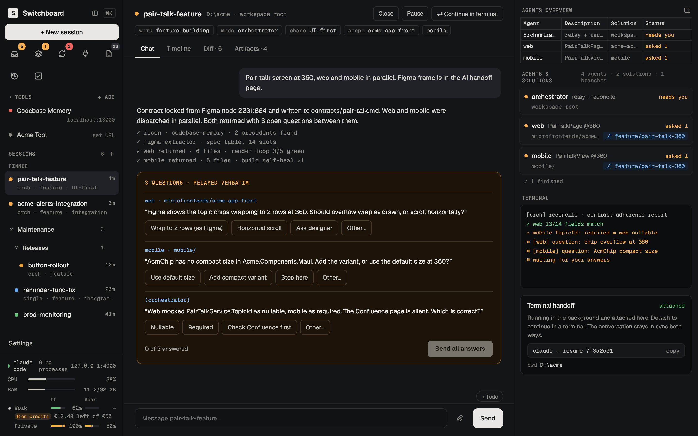

# Switchboard

[](https://m8ven.ai/mcp/marcingadomski94/switchboard?s=readme)

<a href="https://www.paypal.com/donate/?hosted_button_id=S9P6C8KLXWRZN" target="_blank" rel="noopener noreferrer"></a>

Switchboard is a local web app for running many **Claude Code**, **Codex CLI** and **OpenCode** sessions at once. Watch every agent work live, answer all their questions from one Inbox, and let Switchboard handle the repetitive parts: todos, plans, loops, CI fixes and account switching. It runs on `127.0.0.1` only, drives the unmodified CLIs with your own logins, sends no telemetry, and updates itself from GitHub releases.



## Features

- **Sessions** on three CLIs in any folder or git worktree, with subagent and Workflow agent chats, undo per turn and CLI switching mid-way. [new session](docs/new-session.md) · [chat](docs/chat.md) · [undo](docs/undo.md)
- **Chats** to plan with a read-only agent, then continue as a session to code. [chats](docs/chats.md)
- **Inbox and Needs you:** every question and permission request in one place; agents report with `turn_status`, so a session waiting on you says so. [inbox](docs/inbox.md)
- **Todo lists** kept by the agent, with estimates, a board, issue import and runs in their own worktree. [todos](docs/todos.md)
- **Artifacts** saved on purpose (Markdown, HTML, Mermaid, images, CSV, PDF), with versions and deletion. [artifacts](docs/artifacts.md)
- **Search** across every message, artifact and todo on every machine. [search](docs/search.md)
- **Loops and schedules** that Switchboard fires and keeps across restarts. [loops](docs/loops.md) · [schedules](docs/schedules.md)
- **CI loop:** failing PR checks go back to the agent; green PRs offer Merge. [ci](docs/ci.md)
- **Accounts and credits:** several logins per CLI, switched on usage limits, allowance before paid credits. [accounts](docs/accounts.md) · [usage](docs/usage.md)
- **Insights** into time, tokens, estimate accuracy, rework, cost and limit forecasts. [insights](docs/insights.md)
- **Paired machines** over Tailscale, with shared accounts, sidebar layout and power stats, and session take-over. [peers](docs/peers.md) · [power](docs/power.md)
- **Phones and tablets:** pair with a QR code, get push notifications, install as an app. [devices](docs/devices.md) · [app](docs/install-app.md)
- **Built-in `switchboard` MCP tools** for todos, artifacts, loops and `turn_status` in every session. [mcp](docs/mcp.md)
- **Plans** run todos as a dependency graph with Jira import, merge modes and Done-on-merge ([plans](docs/plans.md)); **Team** of role agents ([team](docs/team.md)); **Project memory** approved by you before any session gets it ([memory](docs/memory.md)). Always on since 2.0.

## Requirements

- Node.js 24 or newer, and git
- Claude Code (`claude`), signed in with a claude.ai subscription
- Optional: Codex CLI, OpenCode, the GitHub CLI (`gh`), Tailscale, a Jira Cloud token

How to install them per OS: [docs/setup.md](docs/setup.md#requirements).

## Install

Each block downloads a release, extracts it only when its checksum matches, installs it, and starts Switchboard now and at every sign-in. Paste a block as a whole. Replace `1.35.0` with the [latest release](https://github.com/MarcinGadomski94/switchboard/releases/latest) if a newer one exists. Other ways to run it (without the service, from source): [docs/setup.md](docs/setup.md).

**macOS:**

```sh
V=1.35.0
DIR=~/Applications/Switchboard
mkdir -p "$DIR"
cd "$DIR"
curl -LO https://github.com/MarcinGadomski94/switchboard/releases/download/v$V/switchboard-$V.tar.gz
curl -LO https://github.com/MarcinGadomski94/switchboard/releases/download/v$V/switchboard-$V.tar.gz.sha256
shasum -a 256 -c switchboard-$V.tar.gz.sha256 && tar -xzf switchboard-$V.tar.gz
cd switchboard-$V
npm ci --omit=dev
npm run service:install -- --start
```

**Linux:**

```bash
V=1.35.0
DIR=~/.local/opt/switchboard
mkdir -p "$DIR"
cd "$DIR"
curl -LO https://github.com/MarcinGadomski94/switchboard/releases/download/v$V/switchboard-$V.tar.gz
curl -LO https://github.com/MarcinGadomski94/switchboard/releases/download/v$V/switchboard-$V.tar.gz.sha256
sha256sum -c switchboard-$V.tar.gz.sha256 && tar -xzf switchboard-$V.tar.gz
cd switchboard-$V
npm ci --omit=dev
npm run service:install -- --start
```

**Windows** (PowerShell; closing the console window the task opens stops Switchboard, so minimise it):

```powershell
$V = "1.35.0"
$Dir = "$env:LOCALAPPDATA\Programs\Switchboard"
New-Item -ItemType Directory -Force $Dir | Out-Null
Set-Location $Dir
curl.exe -LO "https://github.com/MarcinGadomski94/switchboard/releases/download/v$V/switchboard-$V.tar.gz"
curl.exe -LO "https://github.com/MarcinGadomski94/switchboard/releases/download/v$V/switchboard-$V.tar.gz.sha256"
$Expected = (Get-Content "switchboard-$V.tar.gz.sha256").Split(" ")[0]
$Actual = (Get-FileHash "switchboard-$V.tar.gz" -Algorithm SHA256).Hash.ToLower()
if ($Actual -eq $Expected) { tar -xzf "switchboard-$V.tar.gz" } else { Write-Error "Checksum mismatch: do not install this download." }
Set-Location "switchboard-$V"
npm ci --omit=dev
npm run service:install -- --start
```

Then open **http://127.0.0.1:13001** (type it or use a bookmark). A setup wizard walks you through the first folder and notifications.

## Updating

Release installs update themselves: **Update** in the banner or Settings → Updates verifies the checksum, switches over and resumes live sessions. Git checkouts and rollbacks: [docs/updates.md](docs/updates.md).

## More

- [Setup, start at login, troubleshooting and development](docs/setup.md)
- [Configuration](docs/configuration.md) · [Security](docs/security.md) · [Privacy policy](PRIVACY.md)
- [Changelog](CHANGELOG.md) · [All docs](docs/) · [Decisions log](docs/decisions.md)

## License

[MIT](LICENSE) © 2026 Marcin Gadomski
