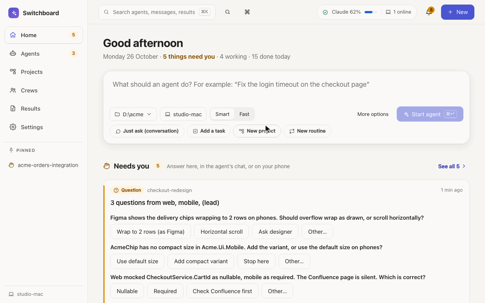
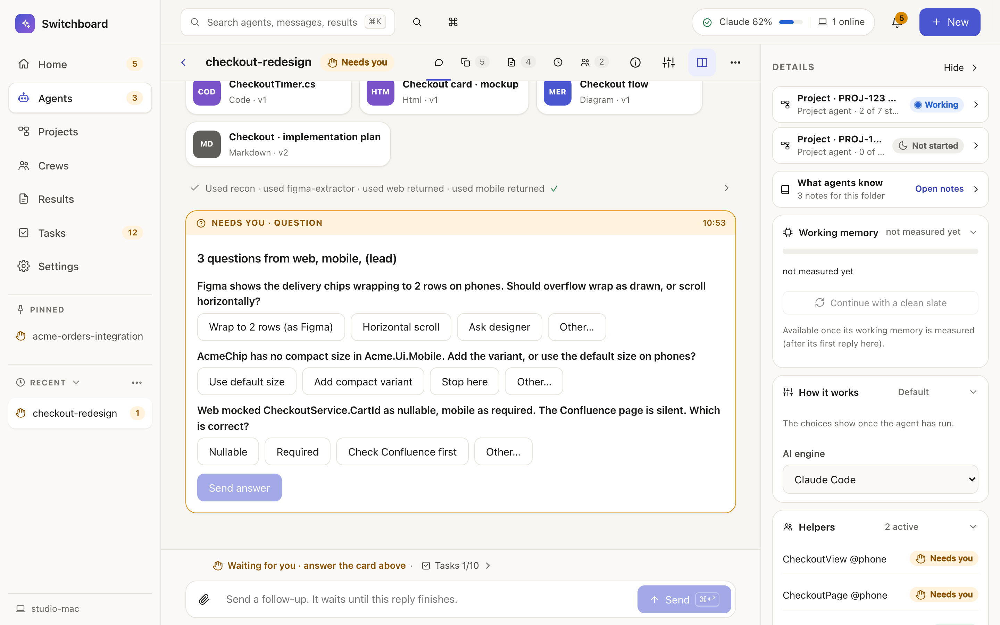
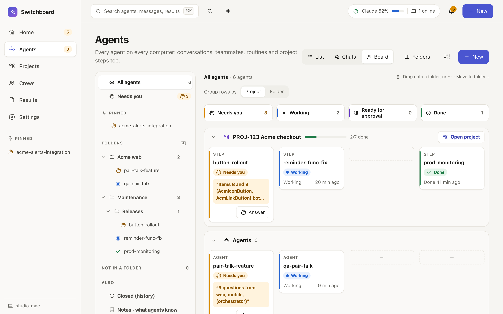
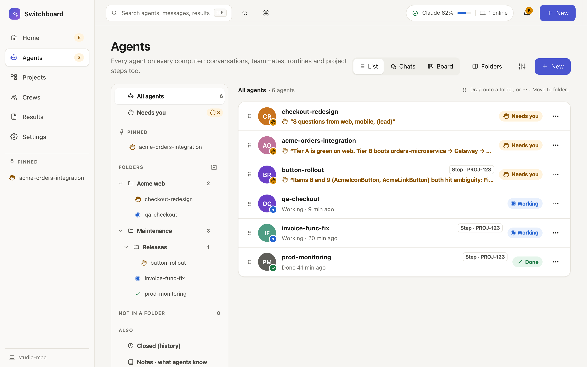
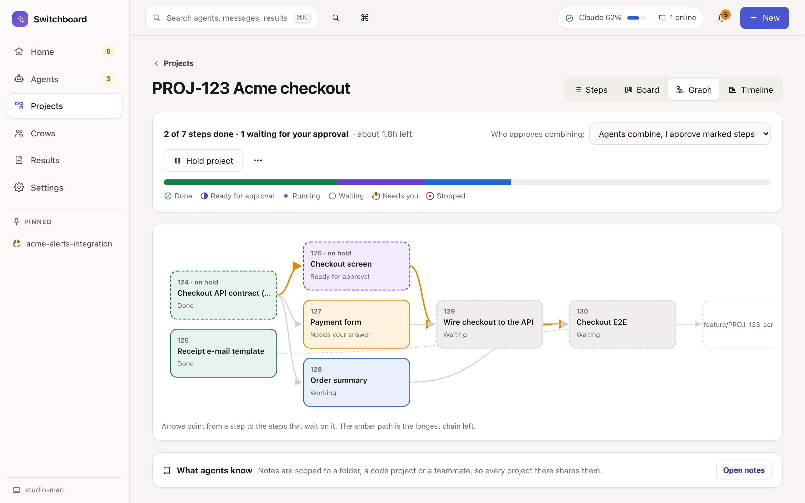
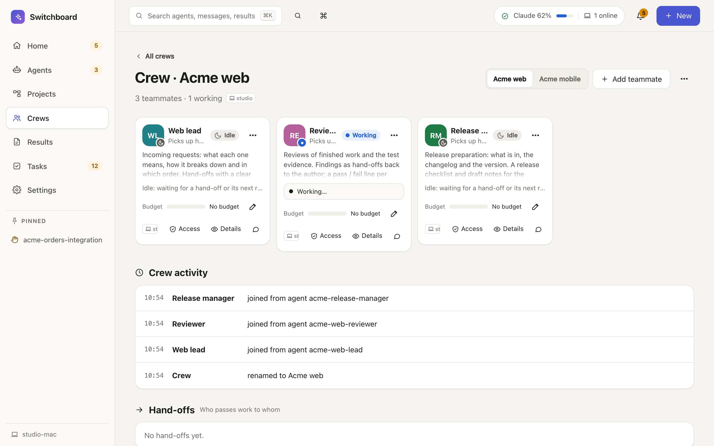
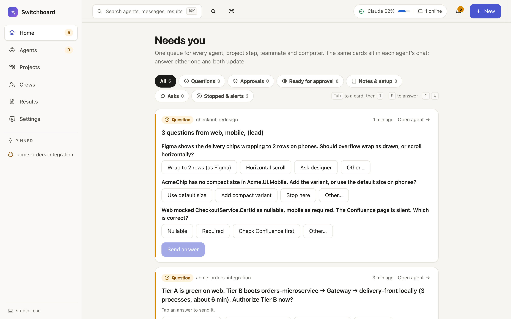
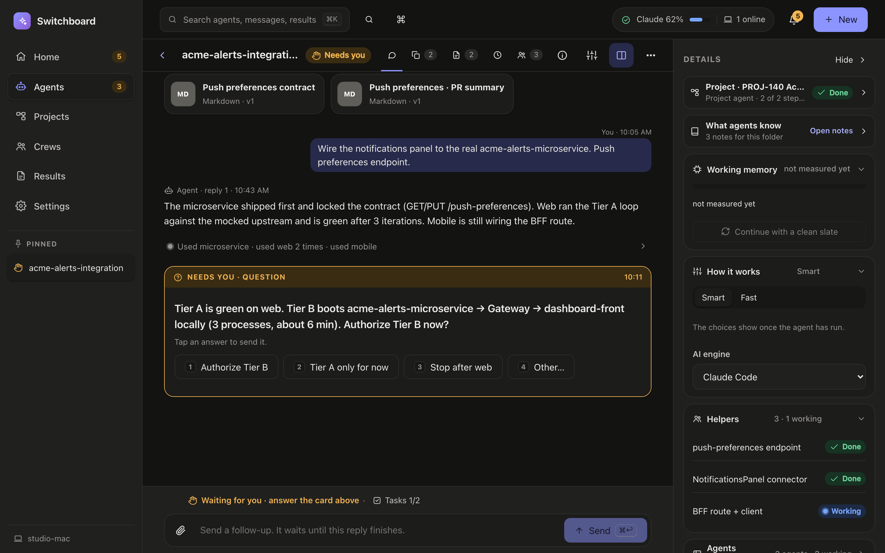
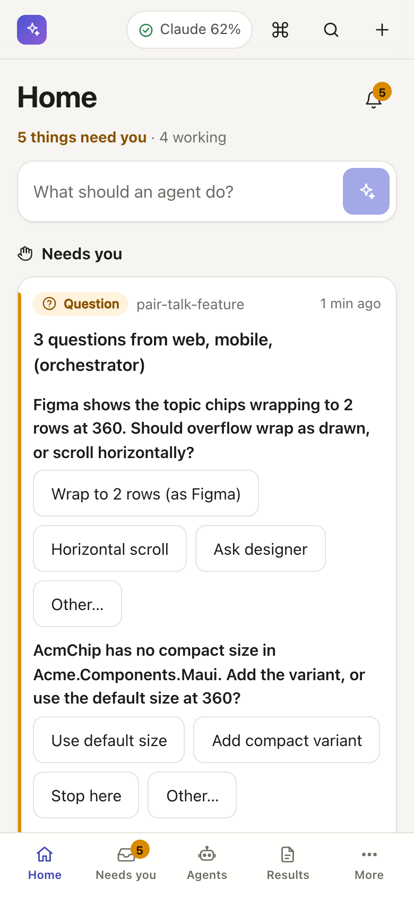
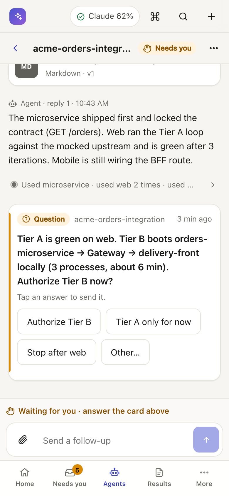

# Switchboard

**Run many Claude Code, Codex and OpenCode agents at once. See what each one is doing and answer them from anywhere, even your phone.**



- **One queue for everything that needs you:** every question, approval and alert from every agent, answered in one click.
- **Projects that run in order:** import a Jira epic and each step starts on its own when the steps before it are done.
- **Usage limits handled:** several logins per AI engine, switched automatically when one runs out.
- **Your other computers and your phone:** pair them over Tailscale or with a QR code, with push notifications.
- **Local only:** runs on `127.0.0.1` with the unmodified CLIs and your own logins; no telemetry, no account.

**[Get started](#install)** · macOS, Linux and Windows · MIT

[](https://github.com/MarcinGadomski94/switchboard/actions/workflows/ci.yml) [](https://www.npmjs.com/package/@marcingadomski94/switchboard) [](https://m8ven.ai/mcp/marcingadomski94/switchboard?s=readme) <a href="https://www.paypal.com/donate/?hosted_button_id=S9P6C8KLXWRZN" target="_blank" rel="noopener noreferrer"></a>

## Switchboard 2

Switchboard 2 opens in a new look, the **v2 theme**, with plain words instead of jargon (agents, tasks, projects, results; [the glossary](docs/v2.md#glossary-the-new-names)), in light or dark, on desktop, tablet and phone:

- **Home:** what needs you, what is working now and what got done today, with a box to start an agent ([the first screen](docs/screenshots/home.png), [the whole page](docs/screenshots/home-full.png)); the same answer cards sit in each agent's chat.
- **Agents:** List, Chats or Board, sorted into folders you drag agents into.
- **The agent view:** the chat with its answer cards, and a side panel (⌘.) with the agent's project, notes, working memory, helpers and settings.
- **Projects:** multi-step work whose steps start on their own when the steps before them are done (Steps, Board, Graph, Timeline).
- **Crews:** long-lived teammates with a job description, grouped into crews, handing work to each other.
- **Results:** everything agents saved on purpose, with versions.
- ⌘K for everything; a short tour, "Welcome to Switchboard 2", shows the new places once.



| Agents · Board | Agents · List and folders |
|---|---|
|  |  |
| **A project (Graph)** | **A crew** |
|  |  |
| **Needs you** | **Dark** |
|  |  |

<p> </p>

**Prefer the 1.x look?** It stays as the **Classic theme**, with the same agents, data and settings. Switch in Settings → Appearance → Theme, or press ⌘K and type "classic"; Classic switches back in its Settings → Appearance. Each browser and phone keeps its own choice. [More on the themes](docs/v2.md#switching-themes-for-users)

## Features

- **Agents** on three AI engines in any folder or separate copy (git worktree), with helper chats, undo per turn and engine switching mid-way. [new agent](docs/new-session.md) · [chat](docs/chat.md) · [undo](docs/undo.md)
- **Conversations** to plan with a read-only agent, then continue as an agent to code. [conversations](docs/chats.md)
- **Needs you:** agents report with `turn_status`, so an agent waiting on you says so. [needs you](docs/inbox.md)
- **Tasks** kept by the agent, with estimates, a board, issue import and runs in their own copy. [tasks](docs/todos.md)
- **Results** saved on purpose (Markdown, HTML, Mermaid, images, CSV, PDF), with versions and deletion. [results](docs/artifacts.md)
- **Search** across every message, result and task on every computer. [search](docs/search.md)
- **Routines** that Switchboard fires on a schedule or in a loop, kept across restarts. [loops](docs/loops.md) · [schedules](docs/schedules.md)
- **Automatic tests:** failing checks on a change request go back to the agent; green ones offer Combine. [ci](docs/ci.md)
- **Accounts and credits:** several logins per AI engine, switched on usage limits, allowance before paid credits. [accounts](docs/accounts.md) · [usage](docs/usage.md)
- **Insights** into time, tokens, estimate accuracy, rework, cost and limit forecasts. [insights](docs/insights.md)
- **Computers** paired over Tailscale, with shared accounts, folders and power stats, and agent take-over. [computers](docs/peers.md) · [power](docs/power.md)
- **Phones and tablets:** pair with a QR code, get push notifications, install as an app. [phones](docs/devices.md) · [app](docs/install-app.md)
- **Projects** run tasks as steps of a dependency graph, with Jira import, approval modes and Done on combine. [projects](docs/plans.md)
- **Crews** of teammates with job descriptions, budgets and access. [crews](docs/team.md)
- **Notes** ("What agents know") that you approve before any agent gets them. [notes](docs/memory.md)
- **Built-in `switchboard` MCP tools** (connections) for tasks, results, routines and `turn_status` in every agent. [mcp](docs/mcp.md)

## Requirements

- Node.js 24 or newer, and git
- At least one agent CLI, installed and signed in: Claude Code (`claude`), Codex CLI (`codex`) or OpenCode (`opencode`). New agents start on Claude Code unless you pick another default CLI in Settings → CLIs, and the setup wizard checks only Claude Code (its rows are information and never block you).
- Claude Code for a few features: Remote Control from the Claude app (needs a claude.ai subscription, not an API key), workflow agents, background tasks and hooking into sessions started in a terminal. [What each CLI supports](docs/providers.md#capability-matrix)
- Optional: the GitHub CLI (`gh`), Tailscale, a Jira Cloud token

How to install them per OS: [docs/setup.md](docs/setup.md#requirements).

## Install

macOS and Linux:

```sh
curl -fsSL https://raw.githubusercontent.com/MarcinGadomski94/switchboard/master/install.sh | sh
```

Windows (PowerShell):

```powershell
irm https://raw.githubusercontent.com/MarcinGadomski94/switchboard/master/install.ps1 | iex
```

Or with npm, on any OS:

```sh
npx @marcingadomski94/switchboard
```

The installer needs Node.js 24 or newer ([how to install it](docs/setup.md#requirements)). It downloads the latest release and installs it only when its SHA-256 checksum matches. It installs the release into `~/Applications/Switchboard` (macOS), `~/.local/opt/switchboard` (Linux) or `%LOCALAPPDATA%\Programs\Switchboard` (Windows). It asks whether to start Switchboard at every sign-in, then starts it. Run it again to upgrade or repair. It never uses sudo, never changes your shell profile and sends no telemetry. You can read [install.sh](install.sh), [install.ps1](install.ps1) and the [npm installer](packages/npx) before you run them. The options (`--service`, `--dir`, `--version`, `--uninstall`) and the manual install are in [docs/setup.md](docs/setup.md#one-line-install).

Then open **http://127.0.0.1:13001** (type it or use a bookmark). A setup wizard walks you through the first folder and notifications.

## Configuration

Switchboard runs with no configuration. Environment variables such as `SWITCHBOARD_PORT` (default `13001`) and `SWITCHBOARD_DATA_DIR` change the port, the data folder, the CLIs it starts and the updater: [docs/configuration.md](docs/configuration.md).

## Updating

Release installs update themselves: **Update** in the banner or Settings → Updates verifies the checksum, switches over and resumes live sessions. Git checkouts and rollbacks: [docs/updates.md](docs/updates.md).

## More

- [FAQ](docs/faq.md): how it differs from Claude Code's own tools, accounts, `curl | sh`, AI, data, platforms
- [Setup, start at login, troubleshooting and development](docs/setup.md)
- [Contributing](CONTRIBUTING.md) · [Reporting a vulnerability](SECURITY.md) · [Code of conduct](CODE_OF_CONDUCT.md)
- [Configuration](docs/configuration.md) · [Security](docs/security.md) · [Privacy policy](PRIVACY.md)
- [Changelog](CHANGELOG.md) · [All docs](docs/) · [Decisions log](docs/decisions.md)

## License

[MIT](LICENSE) © 2026 Marcin Gadomski
